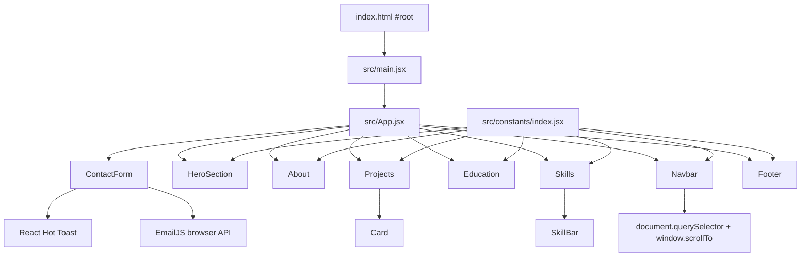

# Portfolio V1 Codebase Audit

**Audit date:** 2026-10-23  
**Repository:** `C:\Users\Bryan\OneDrive\Documents\Bryan Docs\bryan-francis`  
**Audited branch/commit:** `main` at `40d881d437100e7462377354d90848db3d0e1539` (`Updated Images`)  
**Live V1:** <https://bryan-francis.vercel.app/>  
**Scope:** Investigation and documentation only. No application source, dependency, configuration, or deployment changes were made.

## Evidence labels and audit limits

- **Verified — source:** directly established from tracked repository files.
- **Verified — build/check:** established by a command run during this audit.
- **Verified — public request:** established by a read-only HTTP request on 2026-10-23.
- **Inference:** a conclusion supported by source evidence but not exercised end to end.
- **Unknown/manual verification:** cannot be proved safely from the repository or without performing a real external action.

The live V1 document returned HTTP 200 and referenced `/assets/index-Dte5oW3e.js` and `/assets/index-hJWHfYA-.css`. A local production build generated the same filenames. This strongly verifies that the audited checkout matches the currently deployed V1 bundle. Browser automation was unavailable, so responsive visual behavior, keyboard traversal, animation behavior, and cross-browser rendering were not directly exercised. No contact-form message was submitted.

## 1. Executive summary

Portfolio V1 is a small, understandable React single-page application and is a suitable **behavioral and structural foundation** for Portfolio V3. Its strongest qualities are its familiar section order, direct in-page navigation, centralized primary content, small component count, clean production build, and simple static deployment model.

It should not be treated as a finished technical foundation without a focused stabilization pass. The most urgent problems are:

1. Every project repository link and the résumé link returned public 404 responses during verification.
2. The first education logo endpoint returned HTTP 500, despite local logo assets being available.
3. The contact form embeds EmailJS identifiers in source, has no visible spam defense, and cannot be confirmed operational without sending a real message.
4. Accessibility gaps affect the mobile menu, icon-only links, form labeling/errors, focus visibility, semantics, and reduced-motion behavior.
5. Images are substantially oversized: the production build emits about 10.8 MB of raster imagery, including a 3.56 MB project screenshot.
6. `npm run lint` fails with two errors in `src/components/ContactForm.jsx`.
7. `npm audit --omit=dev` reports one critical advisory in the direct `swiper` dependency. `swiper` is not imported by the application and should be removed after confirming it has no intended future use.
8. Several other direct dependencies and about 89 MB of tracked media appear unused, increasing maintenance and repository weight.

The recommended strategy is incremental: first repair links, accessibility, content/data contracts, asset delivery, and dependency hygiene; then redesign individual sections on the same single-page React/Vite shell. A framework migration is not justified by the current requirements alone.

## 2. Repository state and technology stack

### Git state

| Item | Result |
|---|---|
| Repository root | `C:\Users\Bryan\OneDrive\Documents\Bryan Docs\bryan-francis` |
| Branch | `main` |
| Upstream | `origin/main` |
| Ahead/behind at audit start | `+0 / -0` |
| Working tree at audit start | Clean |
| Remote | `https://github.com/Yan-024/bryan-francis.git` |
| Committed source audited | Commit `40d881d` |
| Local pre-existing uncommitted changes | None |
| Audit-created deliverables | This report and `PORTFOLIO_V1_PROJECT_INVENTORY.md` |

The production build created an ignored `dist/` directory for verification; it was removed after the audit. It was never tracked or committed.

### Technology-stack overview

| Area | Technology | Evidence and assessment |
|---|---|---|
| UI framework | React 18.3.1, React DOM 18.3.1 | `package.json`; mounted with `createRoot` in `src/main.jsx` |
| Language | JavaScript with JSX | `.js`/`.jsx`; no TypeScript application files or `tsconfig` |
| Build/dev server | Vite 5.3.4 with `@vitejs/plugin-react` | `vite.config.js`, package scripts |
| Package manager | npm | `package-lock.json` lockfile version 3; exact intended npm/Node versions are not declared |
| Styling | Tailwind CSS 3.4.6 plus 13 lines of global CSS | `tailwind.config.js`, `postcss.config.js`, `src/index.css` |
| Routing | No router; one page with fragment targets | `src/App.jsx`, `NAVIGATION_LINKS`, `Navbar.handleLinkClick` |
| Animation | Framer Motion; React Intersection Observer in footer | Used throughout section components |
| Icons | `react-icons` and `lucide-react` | Skills/social/nav icons and project GitHub icon |
| Forms/notifications | EmailJS Browser and React Hot Toast | `src/components/ContactForm.jsx` |
| Prop validation | PropTypes | `Card.jsx`, `SkillBar.jsx` |
| Font | Google Fonts-hosted Inter | `src/index.css:1`; import syntax is malformed—see findings |
| Third-party content | EmailJS, Google Drive, Google Fonts, GitHub, Facebook, LinkedIn, remote education-logo hosts | Source URLs and imports |
| Hosting | Vercel in production | Verified live Vercel URLs; no `vercel.json` is committed, so deployment uses platform/default settings |
| Linting | ESLint 8 with React, Hooks, and Refresh plugins | `.eslintrc.cjs`; current lint fails |
| Automated tests | None configured | No test script, test files, runner, or browser-test configuration found |

### Dependency overview

Runtime dependencies actively imported by source:

- `@emailjs/browser`
- `framer-motion`
- `lucide-react`
- `prop-types`
- `react`
- `react-dom`
- `react-hot-toast`
- `react-icons`
- `react-intersection-observer`

Direct runtime dependencies with no source import found:

- `@fortawesome/fontawesome-svg-core`
- `@fortawesome/free-brands-svg-icons`
- `@fortawesome/free-solid-svg-icons`
- `@fortawesome/react-fontawesome`
- `clsx`
- `react-slick`
- `slick-carousel`
- `swiper`
- `tailwind-merge`

These should be treated as removal candidates, not deleted blindly. `swiper` is especially important: **Verified — build/check:** `npm audit --omit=dev --json` reported one critical prototype-pollution advisory affecting the installed `swiper@11.1.14`. Because it is unused, removal is the lowest-complexity remediation after a final usage check.

The two `@types/react*` packages are also unnecessary for the current JavaScript-only source unless editor tooling intentionally relies on them.

### Build and checks

| Check | Result |
|---|---|
| `npm run build` | Pass; 1,963 modules transformed; Vite build completed in 10.40 s |
| Built JavaScript | 314.82 kB, 104.00 kB gzip |
| Built CSS | 19.44 kB, 4.35 kB gzip |
| Built raster assets | Approximately 10.85 MB total before transfer compression |
| `npm run lint` | Fail: 2 errors in `ContactForm.jsx` |
| Production dependency audit | 1 critical advisory (`swiper`, unused in source) |
| Unit/integration/E2E tests | Not available |

The first sandboxed build attempt failed with an environment-specific `EPERM` while resolving the OneDrive parent path. Re-running the same existing build outside that restriction succeeded. This is not evidence of an application build defect.

## 3. Annotated repository structure

```text
bryan-francis/
├── .git/                         # Git metadata; main tracks origin/main
├── .eslintrc.cjs                # ESLint rules for React/Hooks/Fast Refresh
├── .gitignore                   # Ignores node_modules, dist, logs, local/editor files
├── index.html                   # Vite HTML shell; title, viewport, favicon, root node
├── package.json                 # npm scripts and direct dependency declarations
├── package-lock.json            # npm lockfile v3
├── postcss.config.js            # Tailwind and Autoprefixer PostCSS plugins
├── tailwind.config.js           # Default Tailwind theme; scans index.html and src/**/*
├── vite.config.js               # Vite React plugin only
├── README.md                    # Unmodified Vite starter text; no project documentation
├── public/
│   ├── logo.png                 # Favicon/runtime public asset; duplicates src/assets/logo.png
│   ├── lithan-logo.png          # Unused local education logo
│   └── uc-logo.png              # Unused local education logo
├── portfolio_img/               # 31 tracked source photos (~66.2 MB); no runtime references
│   ├── *.jpg / *.png            # Portfolio/branding source imagery
│   └── *.HEIC                   # 18 browser-unsuitable source photographs
└── src/
    ├── main.jsx                 # React entry; StrictMode; imports global CSS
    ├── App.jsx                  # Single-page component order and <main> shell
    ├── index.css                # Google font import, Tailwind layers, root font, unused shadow class
    ├── constants/
    │   └── index.jsx            # Navigation, profile, about, projects, skills, education, social data
    ├── components/
    │   ├── Navbar.jsx           # Fixed desktop nav, mobile disclosure, smooth-scroll handlers
    │   ├── HeroSection.jsx      # Full-viewport photo hero and entrance animation
    │   ├── About.jsx            # Biography, profile portrait, résumé action
    │   ├── Skills.jsx           # Technical groups plus component-local professional skills
    │   ├── SkillBar.jsx         # Animated percentage bar/counter
    │   ├── Education.jsx        # Alternating vertical timeline
    │   ├── Projects.jsx         # Responsive two-column project grid
    │   ├── Card.jsx             # Project presentation and GitHub action
    │   ├── ContactForm.jsx      # Client-side validation and EmailJS submission
    │   └── Footer.jsx           # Monogram, social links, intersection-triggered animation
    └── assets/
        ├── logo.png             # BE monogram used by navbar/footer
        ├── bryanFrancis1.jpg    # Hero photograph
        ├── profilePic.jpg       # About portrait
        ├── *project*.png        # Four displayed project screenshots
        └── other images         # 14 unused source assets plus duplicate local logos
```

## 4. Application architecture and component map

### Entry, hierarchy, and data flow



`src/main.jsx` mounts `App` in React Strict Mode. `src/App.jsx` renders one linear page and is the only page-level composition layer. There are no route files, context providers, global stores, custom hooks, utility modules, or backend code.

### Component inventory

| Component | Responsibility | State/data | Reuse assessment |
|---|---|---|---|
| `App` | Sets global visual shell and section order | None | Keep as the single-page composition root |
| `Navbar` | Desktop/mobile navigation and smooth scrolling | Local `isMobileMenuOpen`; `NAVIGATION_LINKS` | Refactor interaction/accessibility, retain behavior |
| `HeroSection` | Full-screen visual introduction | `PROFILE`; local hero import | Redesign visuals/content; structure is simple |
| `About` | Biography, facts, portrait, résumé | `ABOUT`; hardcoded résumé URL | Refactor data/actions and redesign presentation |
| `Skills` | Two technical categories and professional skills | `SKILLS`; local `softSkills` | Redesign into three capability groups |
| `SkillBar` | Animated percentage meter | Local counter and Framer controls | Remove if percentage model is dropped |
| `Education` | Alternating timeline | `EDUCATION` | Retain data mapping; redesign row presentation |
| `Projects` | Grid and entrance/hover motion | `PROJECTS` | Refactor into chapter/index/archive composition |
| `Card` | Project image/content/source link | Props | Refactor into project summary/archive variants |
| `Contact` | Controlled form, validation, EmailJS request | Local form/errors/sending | Product decision: simplify or harden |
| `Footer` | Brand mark, social actions, copyright | `SOCIAL_MEDIA_LINKS`, `useInView` | Keep content role; refactor semantics/accessibility |

### Maintainability assessment

Strengths:

- The main content arrays are centralized and easy to locate.
- Section boundaries are explicit and small.
- The page has minimal state and no unnecessary global state system.
- Build configuration is conventional and very small.
- A single-page architecture aligns with recruiter scanning and fragment navigation.

Concerns:

- `src/constants/index.jsx` mixes content, JSX icon instances, and imported assets. That makes content less portable to JSON/CMS/server rendering and couples data to React.
- Professional skills and the résumé URL are exceptions to centralization and live inside components.
- Projects represent technologies twice conceptually: as a pipe-delimited `subtitle` and an optional `technologies` prop. No project supplies `technologies`, so chip rendering in `Card` is dead at runtime.
- Array indexes are used as React keys throughout. Static arrays tolerate this, but V3 filtering/reordering and active-project navigation need stable IDs.
- Animation settings repeat across components rather than using shared variants/tokens.
- Styling is almost entirely inline utility strings, with no semantic design tokens or primitives beyond Tailwind defaults.
- The README contains only Vite starter text; setup, architecture, content editing, EmailJS configuration, accessibility expectations, and deployment are undocumented.
- Multiple unused dependencies and large unused assets obscure the real runtime surface.

## 5. Homepage and navigation audit

### Rendered source order

| Order | Section | Component/source | Fragment ID |
|---:|---|---|---|
| 1 | Fixed navigation | `src/components/Navbar.jsx` | None |
| 2 | Hero | `src/components/HeroSection.jsx` | `hero` |
| 3 | About Me | `src/components/About.jsx` | `about` |
| 4 | Skills | `src/components/Skills.jsx` | `skills` |
| 5 | Education | `src/components/Education.jsx` | `education` |
| 6 | Projects | `src/components/Projects.jsx` | `projects` |
| 7 | Let's Connect | `src/components/ContactForm.jsx` | `contact` |
| 8 | Footer | `src/components/Footer.jsx` | None |

### Navigation behavior

**Verified — source:** `NAVIGATION_LINKS` contains About, Skills, Education, Projects, and Contact fragment hrefs. `Navbar.handleLinkClick` prevents the browser's default anchor behavior, finds the target with `document.querySelector`, subtracts a hardcoded 140 px offset, and calls `window.scrollTo({ behavior: "smooth" })`. Clicking the logo separately scrolls to `top: 0`.

Consequences:

- There is no route library and no page routing.
- No active section is tracked and no link uses `aria-current`.
- Preventing the default means the URL fragment/history is not updated, so sections are not deep-linkable through these clicks and browser history does not record them.
- The fixed `-140` offset is coupled to the current navbar geometry and may be excessive on the smaller mobile header.
- Native fragment navigation with CSS `scroll-margin-top` would be simpler and more resilient.

Desktop navigation is shown only at Tailwind's `lg` breakpoint (default 1024 px). It uses a fixed, centered, `max-w-2xl` (42 rem) translucent container, a 90 px logo, and five horizontally spaced links.

Below `lg`, a logo and menu button are shown. The button toggles a conditionally rendered vertical list; selecting a link closes it. There is no overlay, focus trap, escape-key handler, outside-click handling, or resize cleanup. A focusable button is present, but `focus:outline-none` removes the visible browser outline and no replacement `focus-visible` style is supplied. It also lacks an accessible name, `aria-expanded`, and `aria-controls`.

### Hero implementation

- `src/assets/bryanFrancis1.jpg` is imported into `HeroSection` and emitted by Vite as a 4,640×3,206 JPEG of 1,261,966 bytes.
- The image is absolutely positioned with `inset-0 h-full w-full object-cover` inside a `min-h-screen` flex container.
- A second absolutely positioned element applies a bottom black gradient. Its responsive gradient stop changes at `lg`.
- The text block is bottom-aligned with `pb-20`, `max-w-3xl`, and left alignment.
- The H1 is uppercase, semibold, tracking-wide, `text-5xl` by default and `md:text-7xl` from 768 px.
- Image, overlay, text, H1, and description each animate on initial load using Framer Motion.
- There is no responsive image source, explicit intrinsic dimension, `fetchpriority`, or reduced-motion branch.

### Homepage interaction/style selectors

This project uses Tailwind utilities rather than stable authored CSS selectors. The stable anchors are `#hero`, `#about`, `#skills`, `#education`, `#projects`, and `#contact`. Important layout utilities include:

- Page: `overflow-x-hidden bg-black tracking-tighter text-gray-200 antialiased`
- Shared sections: `container mx-auto ... max-w-7xl`
- Navbar: `fixed ... top-4 z-50`; desktop `hidden ... lg:flex`; mobile `lg:hidden`
- Hero: `min-h-screen`, `object-cover`, `md:text-7xl`
- Project grid: `grid-cols-1 sm:grid-cols-2 lg:grid-cols-2`

## 6. Skills audit

### Current implementation

Technical skills are defined in `SKILLS` at `src/constants/index.jsx:75` and rendered by `Skills` through reusable `SkillBar` rows.

| Group | Skills and stored percentages |
|---|---|
| Front-end | HTML 75%, CSS 75%, JavaScript 65%, React 70%, Bootstrap 70% |
| Back-end | Spring Boot 65%, Java 65%, MySQL 75%, Spring 65%, Node.js 65% |
| Professional Skills | Time Management, Communication, Adaptability, Problem-Solving, Creativity; names/icons are hardcoded inside `Skills.jsx` |

Each technical skill stores `name`, percentage string under `experience`, a Tailwind bar color, and a pre-instantiated React icon. All bars currently use `bg-gray-500` despite the per-item field.

`SkillBar` parses the percentage, starts a Framer width animation from zero to the string percentage, and runs a 15 ms interval that increments the displayed number by one until it reaches the target. The effect starts when the component mounts, not when the row enters the viewport. It is cleaned up on unmount/re-run.

Responsive behavior:

- Technical categories stack until `md` (768 px), then become two half-width columns.
- Professional skills use three columns even at the smallest width and five columns at `lg`; long labels plus `p-6` may become cramped on narrow phones.

### Technical limitations

- Percentage precision is subjective and is not backed by evidence or proficiency criteria.
- Front-end/back-end naming and duplicated Spring entries do not support the intended three-capability narrative.
- Data shape is coupled to progress-bar UI (`experience`, `color`, React icon node).
- Professional skills use a separate local data source, preventing one consistent content model.
- Timer-based counters create unnecessary work and animation; reduced-motion preferences are not observed.
- Duplicate `FaLightbulb` imagery represents both Adaptability and Creativity.

### V3 recommendation

Replace `SKILLS` with a UI-neutral capability model containing stable IDs, group title, concise capability statement, proof points, and technology labels. Use these three groups:

1. Frontend Development
2. Backend / Software Development
3. UI/UX Design

Render editorial capability blocks or lists instead of proficiency percentages. Keep icons optional and decorative. Move professional strengths into the same content layer or integrate them into About. This is a localized data-and-component refactor; it does not require a framework rewrite.

## 7. Education audit

### Content inventory

| Institution | Qualification | Dates | Location | Logo source | Reachability on 2026-10-23 |
|---|---|---|---|---|---|
| Lithan EduCLaaS | Applied Degree in Software Engineering (BDSE) | 2023 - Present | Singapore | Remote EduCLaaS PNG in `src/constants/index.jsx:104` | HTTP 500 from endpoint |
| University of Cebu | Bachelor of Science in Information Technology (SE) | 2023 - Present | Banilad, Philippines | Remote Wikimedia JPEG | HTTP 200 |
| University of Cebu | Senior High School (K-12):STEM | 2021-2023 | Lapu-Lapu & Mandaue, Philippines | Same remote Wikimedia JPEG | HTTP 200 |

Local `public/lithan-logo.png`, `public/uc-logo.png`, `src/assets/lithan-logo.png`, and `src/assets/uc-logo.png` exist, but `Education` does not use them. The `public/` and `src/assets/` copies are byte-for-byte duplicates.

### Layout and animation

`Education.jsx` renders a centered vertical line from `top-36` to `bottom-36` at `sm` and above. Cards alternate using `sm:flex-row`/`sm:flex-row-reverse`, are each half-width, and animate from alternating ±50 px X offsets. Timeline dots are absolutely centered. Below `sm` the line and dots disappear, and cards become full-width stacked blocks.

The timeline is isolated to this component, so it can be replaced without disrupting other sections. The data map is reusable, although the date strings should use consistent punctuation/spacing and should be reviewed for current accuracy before V3 launch.

### Recommended restructuring

- Retain a centralized education array with stable IDs.
- Switch logos to verified local optimized assets or omit them for a more editorial presentation.
- Render compact semantic rows with institution, qualification, location, and dates; use a list (`ol`/`li`) if chronology matters.
- Remove alternating spatial logic and horizontal entrance motion.
- Treat “Present” dates as content requiring manual confirmation before release.

## 8. Projects audit

The complete field-level inventory is also available in `PORTFOLIO_V1_PROJECT_INVENTORY.md`.

### V1 project summary

| Project | Technologies in code | Screenshot | Source link status | V3 disposition |
|---|---|---|---|---|
| Dobu Martial Arts | HTML, CSS, Javascript, JQuery | `src/assets/DobuMartialArts.png` | Public GET returned 404 | Candidate to evaluate against V2 inventory |
| ABC Cars Portal | Spring Boot, Java, MySQL | `src/assets/ABCCarsportal.png` | Public GET returned 404 | **Future removal requested** |
| Boutiqa | Axure, Prototyping, Wireframing | `src/assets/Boutiqa.png` | Public GET returned 404 | **Future removal requested** |
| Meals on Wheels | PHP, Laravel, Vue, MySQL | `src/assets/MealsOnWheels.png` | Public GET returned 404 | Candidate to evaluate against V2 inventory |

No project defines a live URL or case-study URL. Each source link is stored under `sourceCodeLink`. A 404 proves only that the URL is not publicly reachable at audit time; it does not prove whether a repository was deleted, renamed, transferred, or made private.

### Rendering and interaction

`Projects.jsx` maps the centralized `PROJECTS` array to `Card`. The grid is one column below 640 px and two columns at `sm` and above (`lg:grid-cols-2` is redundant). Cards animate into view from alternating horizontal directions and receive a 1.05 hover scale; `Card` adds its own 1.03 hover scale, creating a compounded scale of about 1.0815.

`Card` displays:

- A fixed-height (`h-48`) `object-cover` screenshot with brightness and zoom hover effects.
- Project title, pipe-delimited subtitle, and description.
- An icon-only GitHub link when `sourceCodeLink` exists.
- Optional technology chips, but the project records never provide the `technologies` array, so no chips render.

The whole card is not interactive. Only the GitHub icon is a link. There is no internal routing, no project detail view, and no live/demo link.

### Dependency map and V3 readiness

```text
src/constants/index.jsx PROJECTS
├── imports four src/assets/*.png screenshots
└── consumed by src/components/Projects.jsx
    └── passes fields to src/components/Card.jsx
        ├── Framer Motion hover behavior
        ├── Lucide GitHub icon
        └── external sourceCodeLink
```

The existing map is adequate for a four-card grid but not for editorial chapters, a sticky index, active scroll tracking, case studies, or a secondary archive.

Recommended project model additions:

- Stable `id` and URL-safe `slug`
- `status`/`visibility` and `featured` flags
- Structured `technologies: string[]`
- Short summary and longer case-study sections
- `role`, `year`, `team`, `outcomes`, and optional metrics only when verified
- `image` plus alt text and optional responsive variants
- Separate `liveUrl`, `sourceUrl`, and `caseStudyUrl`
- Optional `archiveOrder`/`featuredOrder`

Recommended composition:

1. Filter the V2-derived data into featured projects and archive entries.
2. Render featured projects as semantic `<article id="project-slug">` chapters.
3. Render a sticky `<nav aria-label="Project index">` on wide screens and a compact non-sticky index on small screens.
4. Track the active chapter with `IntersectionObserver`; links remain normal fragments so deep linking works without JavaScript.
5. Render secondary projects through a compact reusable archive row/card.
6. Keep case studies as optional links initially. Introduce a router only if V3 actually adds internal detail routes.

The current two-column grid can coexist temporarily while the new data model is introduced, enabling incremental migration.

## 9. Contact and footer audit

### Contact form

`ContactForm.jsx` uses controlled `name`, `email`, and `message` fields. `validate` requires non-empty values and applies a basic email regular expression. On valid submission, `handleSubmit` calls EmailJS directly from the browser, shows a success/error toast, clears the form on success, and toggles an `isSending` disabled state around the promise.

**Verified — source:** EmailJS service, template, and public-key identifiers are hardcoded in `ContactForm.jsx:47-50`. Their values are intentionally not reproduced in this report. No `.env` file or environment-variable reference was found. In EmailJS, a browser public key is expected to be public, but service configuration still needs origin restrictions and abuse controls.

Potential failures and limitations:

- **Unknown/manual verification:** the form was not submitted, so current EmailJS service/template validity and actual delivery are unverified.
- No honeypot, CAPTCHA, throttling, server-side rate limit, or visible origin-defense configuration is present in the repository.
- Validation does not trim whitespace, enforce length limits, or protect against repeated sends beyond the active request.
- Inputs use placeholders instead of labels; validation messages are not programmatically connected to fields.
- Errors are not announced through field-level live regions or focus management.
- The caught error is ignored while lint flags it as unused; the console receives only `FAILED...`, reducing diagnostic value.
- The form has no privacy/use notice explaining how a visitor's message data is handled.

For V3, direct email and LinkedIn actions are a reasonable low-maintenance option if inbound form volume is not a requirement. The About section currently displays the email and LinkedIn name as plain text, not actions; the footer has an external LinkedIn icon link. If the form is retained, move identifiers to documented `VITE_EMAILJS_*` variables, configure provider-side domain restrictions, add accessible labels/errors, length constraints and an anti-spam strategy, and document the delivery owner.

### Résumé and footer

The résumé is an anchor containing a nested `motion.button` in `About.jsx:127-141`. Nested interactive elements are invalid HTML and can produce confusing keyboard/screen-reader behavior. The public Google Drive URL returned 404 during both HEAD and GET verification. Use a single styled anchor and a stable hosted PDF/download URL in V3.

`Footer.jsx` renders a `motion.div`, not a semantic `<footer>`. It contains the BE monogram, an animated yellow bar, three icon-only external links (Facebook, GitHub, LinkedIn), and a hardcoded 2024 copyright. The social anchors lack accessible names. The LinkedIn response code was 999, which is commonly an automated-request block and is therefore **not evidence that the human-facing URL is broken**; manual browser verification is required. Facebook and the GitHub profile returned HTTP 200.

## 10. Styling, layout, and asset inventory

### CSS architecture and design values

`src/index.css` contains Tailwind's base/components/utilities layers, sets Inter on `:root`, and defines an unused `.white-shadow` rule. All component styling otherwise uses Tailwind utility strings.

The Google Fonts import includes an erroneous trailing `" rel="stylesheet` fragment inside the CSS URL. This likely makes the requested URL invalid or requests an unintended query value; font loading should be verified and corrected. A self-hosted variable font would remove this external dependency and improve privacy/reliability.

Current visual vocabulary:

- Backgrounds: black, zinc-900, zinc-800, translucent black/zinc layers.
- Text: white, gray-200/300/400.
- Accents: yellow-400/500/900, teal-400/500, pink-700 errors.
- Typography: Inter; large semibold section titles; tight global letter spacing; uppercase hero H1.
- Corners: `rounded-md`, `rounded-lg`, `rounded-xl`, `rounded-full`.
- Motion: opacity/translation entrances, spring movement, scale/brightness/box-shadow hover effects.
- Layout: Flexbox for navigation/about/skill columns and CSS Grid for facts, professional skills, and projects.

Tailwind's default breakpoints apply because `theme.extend` is empty:

| Prefix | Minimum width | Current uses |
|---|---:|---|
| `sm` | 640 px | Section padding, education timeline, two-column projects |
| `md` | 768 px | Hero title, About facts, Skills columns |
| `lg` | 1024 px | Desktop nav, About split, larger padding, five professional-skill columns |

Notable sizing foundations:

- Main content max width: `max-w-7xl` (80 rem) in About, Skills, and Projects.
- Contact and hero text: `max-w-3xl` (48 rem).
- Desktop nav: `max-w-2xl` (42 rem).
- About portrait: `max-w-xs` (20 rem).
- Spacing is utility-driven but not tokenized into section-level conventions.

### Runtime asset inventory

| Asset | Purpose | Dimensions | Bytes | V3 recommendation |
|---|---|---:|---:|---|
| `src/assets/logo.png` | BE monogram in nav/footer | 500×500 | 21,362 | Reuse; crop/convert to transparent SVG or optimized WebP/PNG if source rights allow |
| `public/logo.png` | Favicon | 500×500 | 21,362 | Reuse but generate proper favicon sizes; duplicate of source logo |
| `src/assets/bryanFrancis1.jpg` | Hero photograph | 4,640×3,206 | 1,261,966 | Strong reuse candidate; create responsive AVIF/WebP variants and deliberate focal positions |
| `src/assets/profilePic.jpg` | About portrait | 2,221×3,024 | 866,583 | Reuse candidate; resize/encode and improve alt text |
| `src/assets/DobuMartialArts.png` | Project screenshot | 1,877×1,049 | 1,096,363 | Reuse only if project remains; optimize and crop intentionally |
| `src/assets/ABCCarsportal.png` | Project screenshot | 1,874×1,008 | 1,429,645 | Retain only until V3 inventory removal is completed |
| `src/assets/Boutiqa.png` | Project screenshot | 1,874×1,345 | 2,612,673 | Retain only until V3 inventory removal is completed |
| `src/assets/MealsOnWheels.png` | Project screenshot | 1,863×1,011 | 3,559,237 | Reuse only if project remains; highest-priority image optimization |

Education uses two remote image URLs instead of bundled assets.

### Unused and duplicate assets

- `src/assets/` contains 21 files totaling about 30.4 MB; only seven imported raster files are used at runtime.
- `portfolio_img/` contains 31 tracked files totaling about 66.2 MB and has no application references.
- Eighteen `portfolio_img` files are HEIC, which should not be used directly as general web assets.
- `bryanFrancis2.jpg`, `joey.jpg`, `prof.jpg`, `project1.jpeg` through `project8.jpeg`, `robertButcher1.jpg`, and local education logos are not rendered.
- `portfolio_img/IMG_20240803_141048.jpg` is byte-identical to `src/assets/bryanFrancis2.jpg`.
- The logo and education logo files are duplicated between `public/` and `src/assets/`.

Do not delete these until V2/V3 content selection and source-asset retention needs are confirmed. Move original/source photography outside the deployable repository or document it as an intentional source library.

## 11. Accessibility, performance, and code-quality findings

### Prioritized findings

| Severity | Finding | Evidence/affected files | Proposed solution |
|---|---|---|---|
| Critical | Unused direct dependency has a critical npm advisory | `package.json` (`swiper`); `npm audit --omit=dev` | Confirm no intended use, remove `swiper`, regenerate lockfile in implementation phase, rerun audit/build |
| High | All four project source URLs are publicly unreachable | `src/constants/index.jsx:50,57,64,71`; verified GET 404 | Correct URLs, intentionally label private/unavailable work, or remove the link action |
| High | Résumé action is publicly unreachable | `src/components/About.jsx:127-141`; verified GET 404 | Host a stable current PDF and use one semantic anchor |
| High | Contact delivery and abuse resistance are unverified | `ContactForm.jsx` | Decide whether a form is needed; if retained, harden provider/domain/rate limits and conduct controlled UAT |
| High | Contact fields have no labels or accessible error relationships | `ContactForm.jsx:86-120` | Add visible `<label>`, `required`, `aria-invalid`, `aria-describedby`, error IDs, focus/error summary |
| High | Mobile menu control has no accessible state/name and removes focus outline | `Navbar.jsx:75-84` | Add name, `aria-expanded`, `aria-controls`, visible `focus-visible` ring; support Escape/focus behavior |
| High | Icon-only project/social links lack accessible names | `Card.jsx:29-36`, `Footer.jsx:41-52` | Add project/social-specific `aria-label` or visually hidden text |
| High | Raster payload is excessive | Build output; hero/About/project assets | Generate responsive AVIF/WebP, right-size, lazy-load below-fold images, preserve hero priority intentionally |
| Medium | Remote Lithan logo is failing | `src/constants/index.jsx:104`; verified HTTP 500 | Use the existing local asset after verifying branding/currentness |
| Medium | No reduced-motion handling | All Framer Motion components | Respect `prefers-reduced-motion`; remove nonessential timers and compounded motion |
| Medium | Invalid nested anchor/button | `About.jsx:127-141` | Use a single styled `<a>` |
| Medium | Lint baseline fails | `ContactForm.jsx:57,77` | Use/log the caught error appropriately; escape apostrophe or configure JSX text correctly |
| Medium | Native anchor semantics/history are overridden | `Navbar.handleLinkClick` | Use regular fragments plus `scroll-behavior`/`scroll-margin-top`; retain progressive enhancement |
| Medium | Weak document/section semantics | Section roots are `div`; footer is `div` | Use `<section aria-labelledby>`, `<footer>`, `<article>`, and list semantics as appropriate |
| Medium | No skip link | `App.jsx`, `Navbar.jsx` | Add “Skip to main content” and a stable main-content target |
| Medium | Form validation is minimal | `ContactForm.validate` | Trim, length-limit, use browser validation appropriately, prevent duplicate abuse, document data handling |
| Medium | SEO metadata is minimal | `index.html` | Add description, canonical, social cards, structured Person/WebSite data, theme color, robust icons |
| Medium | Google Font import is malformed/external | `src/index.css:1` | Correct or self-host the font; use display strategy and fallbacks |
| Medium | Images omit intrinsic dimensions and lazy loading | `HeroSection`, `About`, `Education`, `Card` | Supply width/height/aspect ratio; lazy-load below-fold imagery; avoid CLS |
| Medium | Project technology chips are dead | `Projects.jsx:50`, `Card.jsx:43-52`, project data | Normalize to a real `technologies` array or remove dead UI |
| Medium | Fixed navigation offset is fragile | `Navbar.jsx:17` | Use CSS `scroll-margin-top` tied to a header token |
| Low | Generic alt text | Navbar/Footer “logo”; About “Profile” | Use contextual alt text or empty alt for decorative duplicates |
| Low | Index keys throughout | Constants mapping consumers | Add stable IDs for content that will filter/reorder |
| Low | Hardcoded 2024 footer year | `Footer.jsx:61` | Update content or derive current year at build/render time |
| Low | Unused rule/dependencies/assets | `index.css`, `package.json`, asset directories | Remove only after V3 asset/content confirmation |
| Low | README is starter text | `README.md` | Document setup, scripts, content model, integrations, checks, deployment |

### Color contrast

Most primary text uses light gray/white on black or dark zinc and is likely strong. However, a full contrast audit was not run against rendered/composited states. `text-pink-700` errors on black/dark backgrounds are a likely normal-text contrast failure and hover/transparent overlays require direct measurement. Treat this as **suspected until measured** with browser accessibility tooling.

### Responsive risks

- Professional skills force three columns on all sub-1024 widths; narrow phones may produce cramped wrapping.
- About's headline remains `text-4xl` at the smallest breakpoint and may dominate narrow layouts.
- Fixed navbar plus a single 140 px scroll offset does not adapt to desktop/mobile header height.
- Project hover scaling can clip or cause visual crowding despite the page's `overflow-x-hidden` mask.
- Horizontal entrance animations begin at ±100 px; `overflow-x-hidden` hides spill but does not address reduced motion.

These are source-supported risks, not direct device-test results.

### Runtime and security observations

- No user HTML injection, `dangerouslySetInnerHTML`, authentication, cookies, storage, or server API is present.
- External links opened in new tabs consistently use `rel="noopener noreferrer"` where implemented.
- Contact form data is sent directly from the browser to EmailJS. The repository does not define a private backend or secrets file.
- No Content Security Policy or permissions policy is configured in repository files. Platform header configuration was not inspected.
- The app logs EmailJS success details to the console and omits useful failure details.
- No error boundary or section-level fallback exists; the small static app reduces but does not eliminate the risk of a total render failure.

## 12. Technical debt and risks

### Highest technical debt

1. **Content/action integrity:** project and résumé links no longer resolve publicly; education content depends on a failing remote image.
2. **Accessibility debt:** keyboard focus, accessible naming/state, form labels/errors, landmarks, and motion preferences need systematic treatment.
3. **Asset debt:** approximately 96.8 MB of source/public media is tracked across `src/assets`, `public`, and `portfolio_img`, while only a small subset is deployed.
4. **Data-model debt:** content records are presentation-shaped and incomplete for V3's project chapters/case studies.
5. **Dependency debt:** nine direct runtime packages are unused; one carries a critical advisory.
6. **Verification debt:** no automated test suite or documented manual QA matrix exists.
7. **Documentation debt:** README and integration configuration guidance are absent.

### Risks during V3 work

- Redesigning before normalizing content may duplicate hardcoded fields and make the sticky index fragile.
- Replacing anchor navigation with a routing framework too early could reduce the simple recruiter flow without adding value.
- Removing the asset directories before selecting V2/V3 imagery could discard useful originals.
- Keeping EmailJS without provider-side controls can invite spam/abuse; removing it without a clear direct-contact design can reduce accessibility for recruiters.
- Scroll tracking can conflict with fixed-header offsets unless navigation IDs and active-state rules are defined first.

## 13. Reusable components and assets

### Keep largely intact

- Vite/React entry and static deployment shape (`index.html`, `src/main.jsx`, minimal `vite.config.js`).
- `App` as a linear, recruiter-friendly composition root.
- `NAVIGATION_LINKS` concept and stable section IDs, after adding a Home/hero decision and native fragment behavior.
- Centralized content-array approach, after separating UI elements from data.
- BE monogram, hero photograph, and About portrait, subject to optimization and final brand review.
- The general idea of a reusable project summary component.

### Refactor

- Navbar scrolling, mobile disclosure, focus/state semantics, and active-section support.
- Content definitions into plain objects with stable IDs and structured links/technologies.
- Shared section/container/heading primitives and motion variants.
- Project card into editorial chapter and compact archive variants.
- Education data rendering into compact semantic rows.
- Footer into a semantic, accessible contact/social endpoint.

### Redesign

- Hero typography/layout for Gallery Monochrome and the “Software Developer / UI/UX Designer” identity.
- Skills into the three requested capability groups.
- Education timeline into editorial rows.
- Projects into editorial chapters, sticky project index, active tracking, and archive.
- Contact into either a direct-action panel or a hardened form.

### Remove after confirmation

- ABC Cars Portal and Boutiqa from the V3 project inventory.
- Percentage-based `SkillBar` if capability groups replace percentages.
- Unused carousel/icon/helper dependencies, particularly vulnerable `swiper`.
- Dead technology-chip path if it is not adopted into the normalized model.
- Unused/duplicate deployable assets after preserving any desired source originals elsewhere.
- Unused `.white-shadow` CSS.

## 14. V1-to-V3 migration recommendation

### Is a framework migration justified?

No, not from the stated V3 requirements alone. React/Vite can support the desired design system, sticky index, `IntersectionObserver` active tracking, responsive image markup, accessible interactions, and static case studies. Vite also keeps deployment and mental overhead low.

A move to Next.js or another framework becomes justified only if V3 requires multiple content-heavy case-study routes with per-page metadata, image transformation infrastructure, CMS/server data, preview workflows, or server-side form handling. Make that decision after the project/content model is finalized, not as a prerequisite to visual redesign.

### Keep / Refactor / Redesign / Remove classification

| Category | Items |
|---|---|
| Keep | React/Vite shell, one-page order, section anchors, simple local state, centralized content concept, core brand/photo assets |
| Refactor | Navigation semantics, plain data models, component keys, motion tokens, asset imports, project links/actions, semantic landmarks, documentation |
| Redesign | Hero, Skills, Education, Projects, Contact, visual tokens/typography, project storytelling/navigation |
| Remove | ABC Cars Portal, Boutiqa, percentage meters, confirmed unused dependencies, obsolete/duplicate deploy assets, dead CSS/props |

### Incremental migration sequence

1. Preserve the live section order and introduce stable content IDs/data shapes without changing appearance.
2. Repair link/content integrity and establish an explicit V2-to-V3 project inventory.
3. Build accessibility and semantic foundations into navbar, sections, links, and form/actions.
4. Add Gallery Monochrome tokens (color, type, spacing, container, borders, focus, motion) in Tailwind/theme CSS.
5. Redesign Hero and About with optimized existing imagery.
6. Replace Skills and Education independently using the normalized content layer.
7. Introduce project chapters and fragment IDs, then the sticky index and active tracking, then the compact archive.
8. Simplify or harden Contact; update the semantic footer.
9. Remove obsolete dependencies/assets only after all migrated content is verified.
10. Add automated smoke/accessibility checks and complete responsive/manual UAT before deployment.

## 15. Prioritized implementation roadmap

### Phase 0 — Decisions and inventory (before UI work)

- Confirm the authoritative V2 project list and exact descriptions, technologies, screenshots, ownership, source/live/case-study URLs.
- Confirm whether Dobu Martial Arts and Meals on Wheels remain.
- Confirm the current résumé file and whether Contact retains a form.
- Confirm education dates and desired institution-logo usage.

### Phase 1 — Stabilize V1

- Fix or intentionally remove broken project and résumé actions.
- Replace the failing external Lithan image with a verified local asset.
- Resolve the two lint errors.
- Remove unused vulnerable `swiper` and other confirmed-unused packages; rerun build, lint, and audit.
- Add labels, accessible names/states, visible focus, landmarks, skip link, and reduced-motion support.

### Phase 2 — Create V3 foundations

- Define plain content schemas with stable IDs.
- Define Gallery Monochrome design tokens with muted olive accents.
- Add shared `Section`, `Container`, heading, link/button, project media, and motion primitives.
- Establish responsive image sizes/formats and source-asset retention rules.

### Phase 3 — Migrate sections incrementally

- Hero/About first, preserving navigation and IDs.
- Skills capability groups.
- Compact Education rows.
- Editorial project chapters, sticky index, active tracking, case-study actions, and archive.
- Contact/footer redesign.

### Phase 4 — Verify and release

- Add component/unit coverage for data transforms and form/navigation behavior.
- Add a browser smoke test for every section link, mobile menu, reduced motion, project actions, and contact path.
- Run automated accessibility checks plus manual keyboard and screen-reader review.
- Test narrow mobile, tablet, desktop, high zoom, slow network, and image-failure states.
- Validate all external URLs and EmailJS delivery immediately before launch.
- Verify metadata/social previews and production analytics only if intentionally added.

## 16. Unanswered questions and manual verification

1. What is the authoritative V2 project inventory? The live V2 URL currently presents a “BryanOS” loading/landing experience; the V2 repository/content source was not part of this workspace.
2. Are the four project repositories private, renamed, transferred, or deleted? Public requests only establish current 404 responses.
3. Should source links be shown for private/team projects, and who owns the Meals on Wheels repository?
4. What are the verified live/demo URLs and case-study destinations for V3 projects?
5. Which résumé is current, and should it be viewed inline or downloaded?
6. Is EmailJS still configured, origin-restricted, monitored, and delivering to the intended inbox? A controlled real submission is required.
7. Are the education dates and “Present” statuses current as of launch?
8. Is the About age intended to remain public and manually maintained?
9. Does the BE monogram have a vector/source file and confirmed reuse rights?
10. Do the project screenshots and source photographs have documented ownership/permission for public reuse?
11. How does the page behave in Safari/iOS, Android Chrome, Firefox, keyboard-only use, screen readers, 200%/400% zoom, reduced motion, and high contrast? These require browser/device UAT.
12. Do rendered color combinations meet WCAG AA after the V3 palette and overlays are applied? A browser-based contrast pass is required.
13. Are any Vercel redirects, headers, environment variables, or project settings configured outside the repository? Repository inspection cannot verify dashboard-only state.

## Conclusion

**Yes—the existing Portfolio V1 codebase is a suitable foundation for Portfolio V3, primarily because its small React/Vite single-page architecture, direct section order, and centralized content are easy to evolve incrementally.** The first work should not be the visual redesign. Start by establishing the authoritative V3 project/content inventory, repairing broken links, normalizing content into stable UI-neutral data, removing the unused vulnerable dependency, and fixing the accessibility and asset-delivery foundations. Once those are stable, redesign Skills, Education, Projects, and Contact one section at a time while preserving the current recruiter-friendly navigation and working single-page flow.
